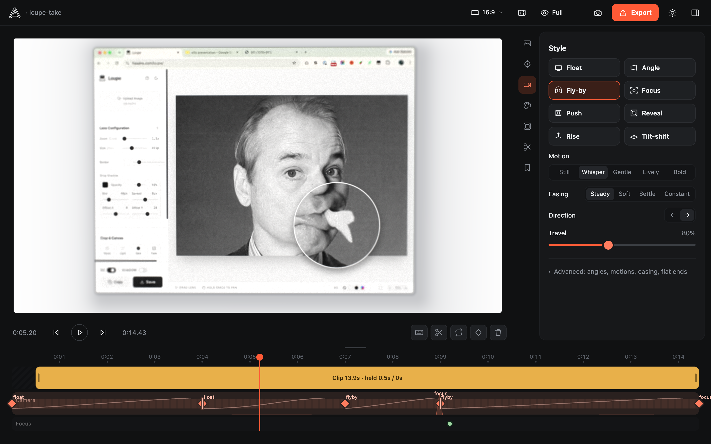
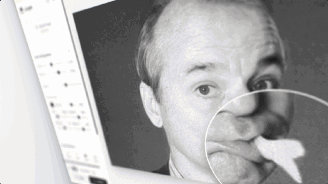
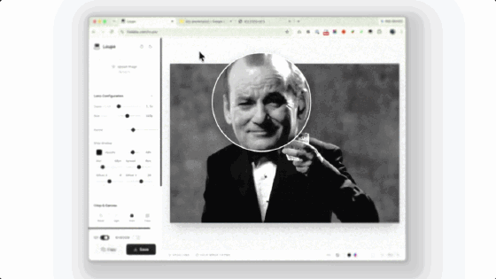
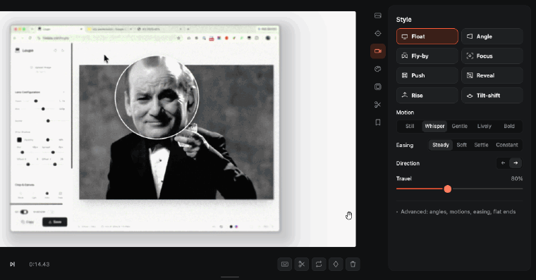
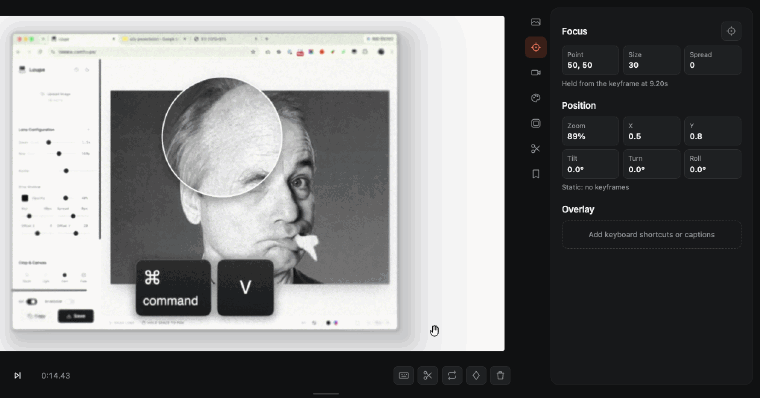
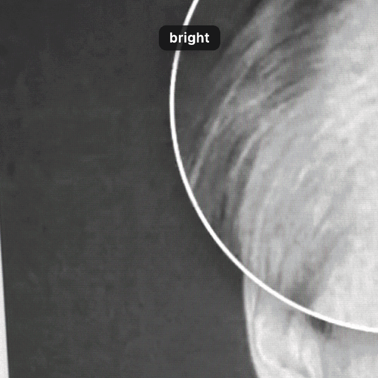
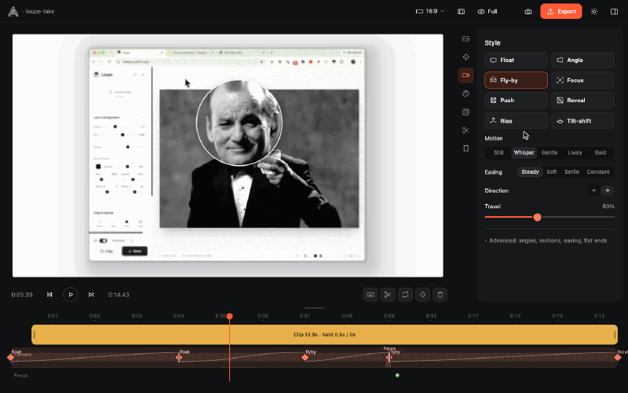
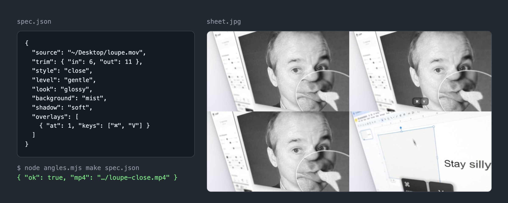

# `angles`

A small studio that turns a screen recording into a calm, photographic product shot, up close and at a real angle, with a slow camera move, a real screen look and soft focus. It runs locally, and Claude can drive it too.

  
[<kbd> haaans.com/angles  </kbd>](https://haaans.com/angles)

## Features

<table>
<tr valign="top">
<td width="50%">
<h3>Get up close at a real angle</h3>

Close and Raking put the camera right on the action with a wide lens, steeply angled, so the screen's edges converge and the far side falls out of focus, like a photo of a real display.

</td>
<td width="50%">

</td>
</tr>
<tr valign="top">
<td width="50%">

</td>
<td width="50%">
<h3>Get a calm camera move</h3>

Drop in a recording and the camera drifts, angles and settles on its own, kept within a motion budget so it never feels like a ride.

</td>
</tr>
<tr valign="top">
<td width="50%">
<h3>Pick a style</h3>

Float, Fly-by, Push, Tilt-shift, Close and more. Each one applies to the span you're in, so one clip can move several ways.

</td>
<td width="50%">

</td>
</tr>
<tr valign="top">
<td width="50%">

</td>
<td width="50%">
<h3>Click to focus</h3>

Pick a point on the picture, then scroll to set how much stays sharp. A purple overlay shows the focus while you adjust it.

</td>
</tr>
<tr valign="top">
<td width="50%">
<h3>Try a screen look</h3>

Bright, glossy, pixel macro, film print. Each one adds the texture of a real display while keeping whites white.

</td>
<td width="50%">

</td>
</tr>
<tr valign="top">
<td width="50%">

</td>
<td width="50%">
<h3>Make room, light or dark</h3>

Hide the panel and the frame glides out to fill the space. Switch between light and dark from the header.

</td>
</tr>
<tr valign="top">
<td width="50%">
<h3>Ask Claude for the video</h3>

The repo is also a Claude skill. Claude writes a ten-line spec and runs <code>node angles.mjs make spec.json</code>, which applies it in the studio and renders it on your machine. It returns the mp4 and one small contact sheet to check, so a video costs a few hundred tokens. To install it, run <code>git clone https://github.com/HansEngebretsen/angles ~/.claude/skills/angles</code> and then <code>npm i</code> in that folder.

</td>
<td width="50%">

</td>
</tr>
</table>
